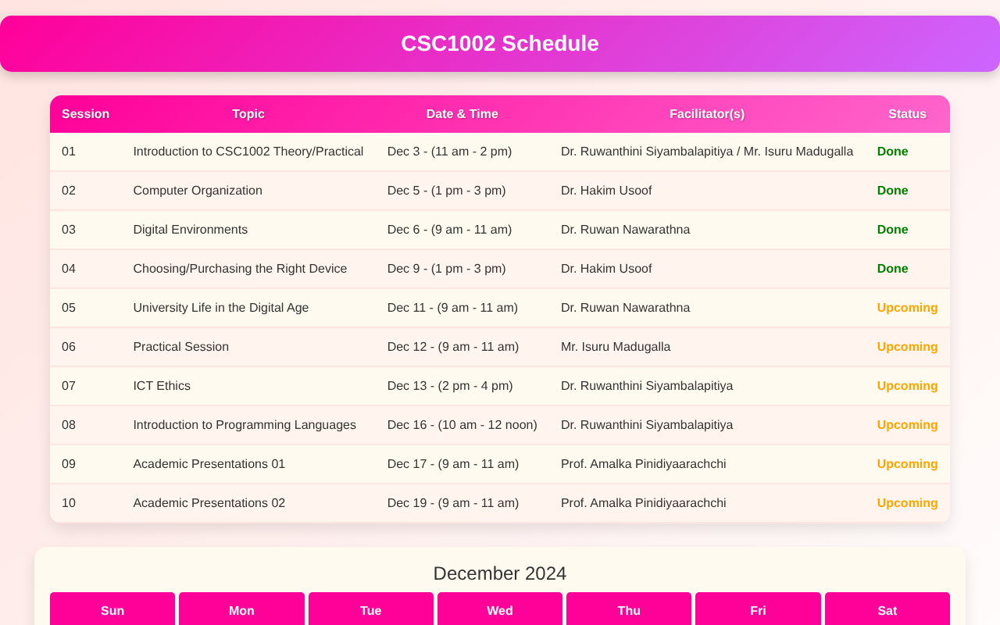

# 📅 CSC1002 Schedule

A one-page session schedule for the CSC1002 course at the University of Peradeniya: topics, dates, facilitators and a December calendar, with Done and Upcoming status.

   

## Features

- Table of all sessions with topic, date and time, facilitator and status
- Each session is marked **Done** or **Upcoming**
- Month calendar with the session days highlighted
- A single `index.html` file with no dependencies

## Run locally

Open `index.html` in any browser. To change the sessions, edit the table rows in that file.

## Author

Made by **Meshan Nawod**, Physics undergraduate at the University of Peradeniya · [Portfolio](https://meshannawod.github.io/) · [GitHub](https://github.com/MeshanNawod)

## License

MIT. See [LICENSE](LICENSE).
